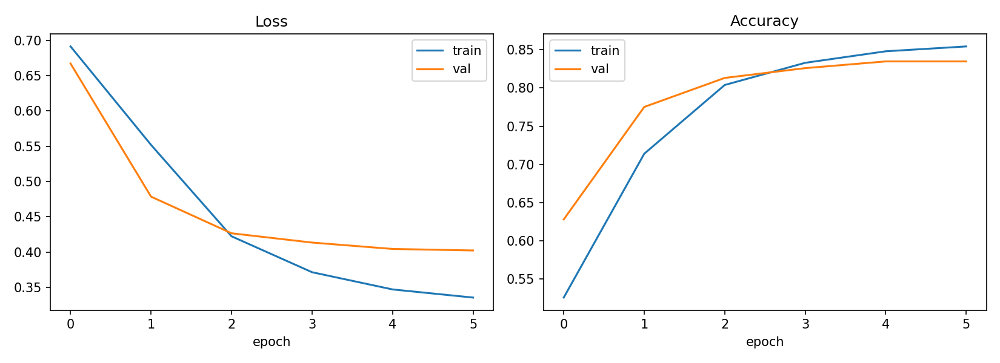
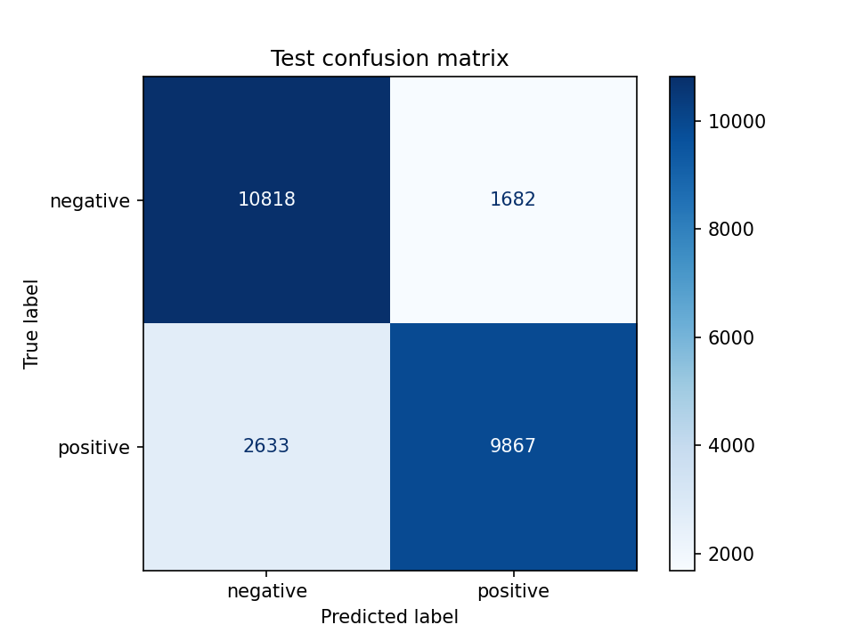

# Transformer from Scratch: IMDB Sentiment Classification

An end-to-end NLP project: a **Transformer encoder implemented from scratch in PyTorch**
(multi-head self-attention, sinusoidal positional encoding, pre-norm residual blocks, masked mean pooling)
trained to classify IMDB movie reviews as positive or negative.

## Highlights
- Own implementation of multi-head attention, encoder layers and classifier (no `nn.Transformer`)
- Padding-aware attention mask and masked pooling
- Word-level tokenizer and vocabulary built from the training split
- Mixed-precision training (AMP), AdamW, OneCycle LR schedule, gradient clipping
- Best-checkpoint saving, test report, loss/accuracy curves, confusion matrix
- Unit tests (shape check, padding invariance, overfit-a-tiny-batch sanity check)
- CLI inference script

## Project structure
```
transformer-sentiment/
├── src/
│   ├── model.py      # attention, encoder, classifier
│   ├── data.py       # tokenizer, vocab, dataloaders
│   ├── train.py      # training + evaluation + plots
│   └── predict.py    # inference on custom text
├── notebooks/colab_run.ipynb   # Colab runner
├── tests/test_model.py
├── assets/           # generated plots
├── requirements.txt
└── README.md
```

## Setup
```bash
python -m venv .venv
.venv\Scripts\activate        # Windows  (source .venv/bin/activate on Linux/Mac)
pip install -r requirements.txt
```
For GPU, install the CUDA build of PyTorch from https://pytorch.org first.

## Usage
```bash
pytest -q                                   # run unit tests
python -m src.train --subset 2000 --epochs 2   # quick smoke run
python -m src.train --epochs 6              # full training
python -m src.predict "A brilliant, moving film."
```

## Run on Google Colab
Open `notebooks/colab_run.ipynb` in Colab (File → Open notebook → GitHub tab), pick a GPU runtime and run all cells.

## Datasets
- Default: Hugging Face `imdb` (25k train / 25k test), downloaded automatically.
- Optional: Kaggle *IMDB Dataset of 50K Movie Reviews* via `--source kaggle --csv <path>`.

## Model
| Setting | Value |
|---|---|
| d_model / heads / layers / d_ff | 128 / 4 / 2 / 256 |
| Max sequence length | 256 tokens |
| Vocabulary | 20k words |
| Optimizer | AdamW, lr 3e-4, OneCycle |

## Results
After training, fill in your numbers here (see `checkpoints/test_report.txt`):

| Metric | Value |
|---|---|
| Test accuracy | 0.82 |
| F1 (macro) | 0.83 |




## Ideas for extension
- Swap the word tokenizer for BPE / WordPiece
- Add learned positional embeddings and compare
- Visualize attention heads
- Fine-tune a pretrained model (e.g. DistilBERT) and compare against this baseline
